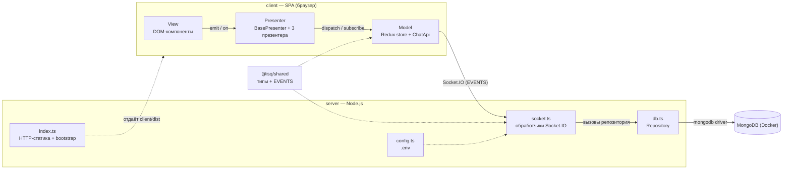
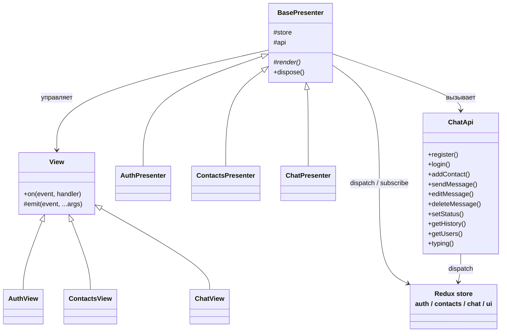
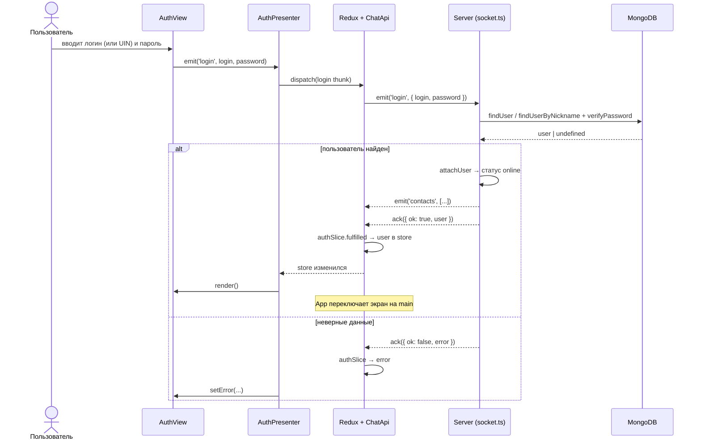
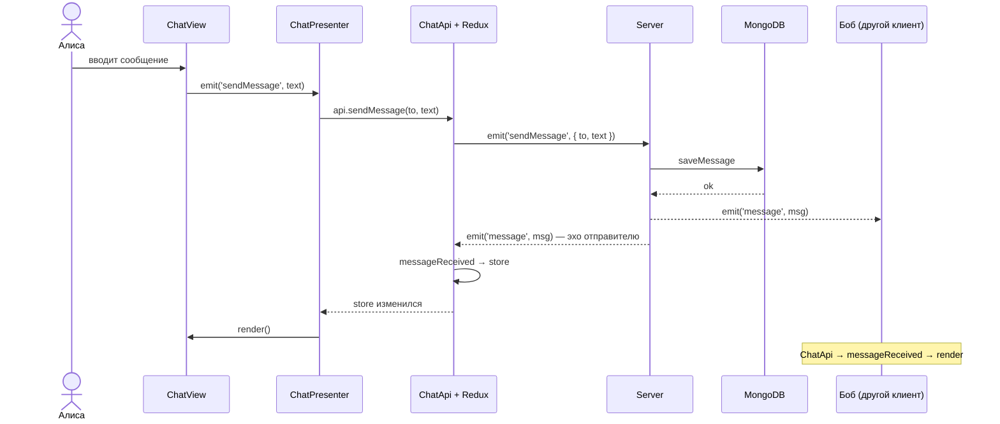
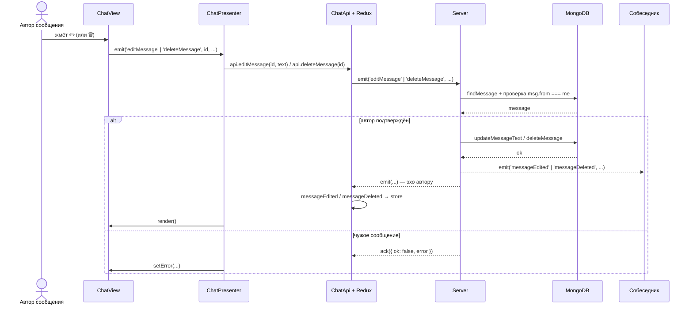

# UML — модель взаимодействия компонентов

Схемы описывают архитектуру MVP и ключевые потоки взаимодействия между клиентом
(браузер), сервером (Node.js) и MongoDB. Формат — **Mermaid**: диаграммы рендерятся
на GitHub/GitLab и в большинстве современных редакторов.

---

## 1. Диаграмма компонентов

Показывает составные части системы и связи между ними.

- **View** → **Presenter**: события пользователя (`emit`) и перерисовка по команде.
- **Presenter** → **Model**: `dispatch` действий Redux и подписка на store.
- **Model** → **Server**: запросы по Socket.IO; имена событий — из `@isq/shared` (`EVENTS`).
- **Server** → **MongoDB**: вся работа с БД инкапсулирована в репозитории `db.ts`.

---

## 2. Диаграмма классов клиента (MVP)

Структура слоёв Model / View / Presenter.

- `BasePresenter` реализует шаблон **Template Method**: подписка на store и абстрактный
  `render()` в базовом классе, привязка событий — в подклассах.
- `ChatApi` — часть Model: превращает входящие события сервера в действия Redux.

---

## 3. Sequence — вход по логину/UIN

---

## 4. Sequence — отправка сообщения

---

## 5. Sequence — редактирование / удаление сообщения

> Удаление отличается от редактирования только событием (`deleteMessage` →
> `messageDeleted`) и отсутствием нового текста.
